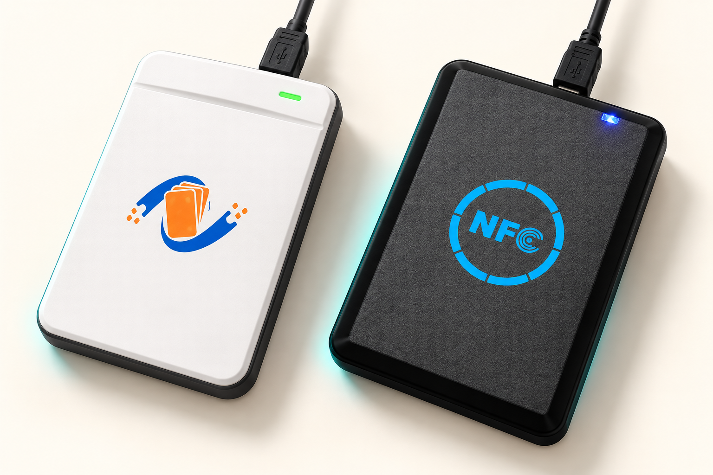

# wCopy NFC for Mac

> **PM6 改进版说明：** 本版基于 [zhjcreator/wcopy-nfc-mac](https://github.com/zhjcreator/wcopy-nfc-mac)，使用 OpenAI Codex 辅助完成 PM6 兼容和自动补读等改动。原有应用和恢复引擎继承自上游，不宣称全部原创。详见[来源、改动及许可核查边界](docs/PROVENANCE.md)与[第三方声明](THIRD_PARTY_NOTICES.md)。

[English](README.md) | 中文

原生 macOS 图形工具，用于 wCopy / NSR106-IDIC V USB NFC 读卡器。项目依据
[`mariogiordano96/wcopy-nfc-linux`](https://github.com/mariogiordano96/wcopy-nfc-linux)
逆向得到的 USB-HID 与 PN532 封装协议重新实现，macOS 侧直接使用 IOKit，不需要内核驱动、
`hidraw`、GTK 或 Python 运行时。

## 设备支持



*根据用户提供的设备参考图由 AI 生成，仅为外观示意，非厂商实拍，也不代表图中设备均已验证兼容。具体支持范围见下表。*

| VID:PID | 状态 |
| --- | --- |
| `0416:b008` | 已在 `wCopy NSR106-IDIC V601` 实机完成 HID 序列同步和初始化握手 |
| `0416:b030` | 上游在 Linux 真机验证过；本项目使用同一协议的原生 macOS 实现 |
| `0416:b029` | PM6 已在固件 `wCopy NSR122-H V701A2` 上完成本地验证；其他固件须实测 |


同样使用 wCopy USB-HID 协议（`0416:b008` / `0416:b030`）的同系列读卡器同样受支持：
应用按 64 字节 HID 接口识别设备，因此其他 wCopy / NSR106-IDIC 风格的同类型 NFC 读卡器
无需修改即可使用。

应用将 USB 枚举和协议兼容性分开显示。看到设备不代表协议已经通过，只有完成序列号同步与
四步初始化后才会显示“协议就绪”。如果 `b008` 同步失败，应用会保留诊断信息，而不会误报连接。

### PN532 兼容范围

兼容已支持的 wCopy/PM6 USB-HID 封装中的 PN532 指令通信。**不代表通用 PN532 裸模块即插即用**：目前没有实现裸模块 UART、I²C 或 SPI 直连。可选 libnfc 桥接提供虚拟 PN532 UART 接口供外部工具使用，仍需已支持的 wCopy 读卡器。

## 功能

- 自动发现 `0416:b008` 和 `0416:b030` 的 64 字节 HID 接口。
- MIFARE Classic Mini、1K、4K 卡片识别，显示 UID、ATQA、SAK。
- 支持 Classic 2K 几何，以及实机验证的 `SAK 19 + ATQA 0004 + 4 字节 UID` 兼容 Classic 1K。
- 选择 Key A / Key B 和扇区范围读取，支持进度与取消。
- 使用分级内置词典或自定义字典逐扇区检查 Key A 与 Key B。
- 支持导入 `.dic`、`.keys`、`.txt`，也可在线载入 Proxmark3/MCT 社区词典；自动解析注释、去重并统计无效行。
- JSON 读取转储兼容上游格式，并扩展保存卡型、ATQA、SAK 和已知的逐扇区密钥。
- 标准 `.mfd`（320 / 1024 / 2048 / 4096 字节）导入与导出。
- 安全恢复：默认跳过块 0 和扇区尾块，可选写后回读验证。
- Magic / CUID 卡 4 字节 UID 修改，自动计算 BCC 并完整回读验证。
- 格式化指定扇区，保留制造块 0。
- 原生 raw PTY 桥接，可选运行 `nfc-list`、`mfoc`、`mfcuk`。
- **原生 Nested 密钥恢复**：进程内重新实现 mfoc 的 Crypto1 与 Nested 认证攻击，无需安装 mfoc 即可恢复未知密钥。
- HID 描述符、握手、日志和原始 PN532 命令诊断。
- Agent 友好的 `wcopy-nfc` CLI，提供稳定 JSON 输出、退出码、只读/写入安全边界和无交互参数。

125 kHz ID 卡暂不支持。上游抓包只发现了轮询命令 `0x65`，但没有成功读卡响应，不能据此实现
可靠功能。UFUID 永久锁定同样未实现，因为没有可验证的芯片专用命令，且操作不可逆。

## 构建

要求 macOS 13 或更新版本，以及 Xcode Command Line Tools / Swift 6。

```bash
swift build
swift test
swift run WCopyNFCMac
```

构建可双击启动的应用包：

```bash
./Scripts/build-app.sh
open "dist/wCopy NFC.app"
```

脚本默认生成当前主机架构的原生 Release 包并进行本机临时签名。若要生成当前工具链支持的通用包：

```bash
ARCHS="arm64 x86_64" ./Scripts/build-app.sh
```

构建产物包括：

- `dist/wCopy NFC.app`：图形应用。
- `dist/wcopy-nfc`：CLI，可直接供终端、脚本或 Agent 调用。

CLI 也可以从 SwiftPM 开发构建直接启动：

```bash
swift run WCopyNFCMac cli devices --pretty
swift run WCopyNFCMac cli capabilities --pretty
```

Release CLI 示例：

```bash
./dist/wcopy-nfc devices --pretty
./dist/wcopy-nfc reader-info --pretty
./dist/wcopy-nfc card-info --card-mode auto --pretty
./dist/wcopy-nfc keys --preset common --card-mode 1k --pretty
```

CLI 的完整命令、JSON schema、退出码、安全规则和 Agent 工作流见 [`docs/CLI.md`](docs/CLI.md)。

macOS 的 IOKit HID 通常不需要类似 Linux udev 的权限规则。若打开失败，请退出官方软件或其他
可能占用同一 HID 接口的应用，再拔插设备。

## 首次使用

1. 插入 NSR106-IDIC V，打开应用并点工具栏的刷新按钮。
2. 选中 `0416:B008`，点击“连接”。首次同步最多需要约 30 秒。
3. 显示“协议就绪”后，将 13.56 MHz MIFARE Classic 卡片放在感应区。
4. 先进入“读取与备份”保存 JSON。注意 MIFARE 硬件会隐藏尾块中的 Key A；需要先通过密钥检查获得完整 A/B 密钥，才可安全导出完整 MFD 或恢复尾块。
5. 如果认证失败，使用“密钥检查”；未知密钥可在“密钥恢复”页使用原生 Nested 恢复（无需 mfoc），或选用外部 `mfoc` 桥接。

## 默认密钥词典

“默认密钥检查”不是对完整 48 位密钥空间的穷举。应用只尝试用户选择的候选集合：

- 常用公开键：独立整理的常见默认值、测试值和公开部署键（含 mfoc 高命中默认集）。
- 弱模式扩展：在常用键基础上生成重复字节、连续递增与连续递减等弱模式。
- 自定义词典：支持 Proxmark3 `.dic`、MIFARE Classic Tool `.keys` 和普通文本。

应用提供 Proxmark3 和 MIFARE Classic Tool 的在线载入入口。下载内容仅在运行时使用，不随本项目
重新分发，并在界面标明其 GPL 来源许可。大型词典可能产生数万次认证，耗时取决于词典大小、
卡型和 USB 响应速度。检查时必须保持卡片稳定。

扫描按候选命中概率执行：先用一个候选检查所有尚未找到的扇区密钥槽，再进入下一个候选。
认证失败后应用会重新选择并核对同一 UID，避免失败状态污染后续候选。若访问位把 Key B 字段
配置为可读数据，结果会显示 `DATA`；该值可用于完整备份，但根据 NXP 规范不能用于 Key B 认证。
扇区密钥单元格支持复制，以及从剪贴板粘贴 6 字节密钥；粘贴值只有通过对应扇区的 Key A/Key B
实际认证后才会保存。标记为 `DATA` 的 Key B 字段不能粘贴认证密钥。

### 非标准 SAK 与强制卡型

标准 SAK 表不能覆盖所有兼容芯片。应用根据实测，在同时满足 `SAK 0x19`、`ATQA 0x0004`、
4 字节 UID 时自动按 SAK 19 兼容 Classic 1K（16 扇区、64 块）处理。卡型列表提供：

- 自动识别（含 SAK 19）
- SAK 19 兼容 Classic 1K
- 强制 Classic Mini
- 强制 Classic 1K
- 强制 Classic 2K
- 强制 Classic 4K

密钥检查识别到 SAK 19 兼容卡后，会自动从 4 字节 UID 生成候选：

```text
Key[0] = UID[0] XOR UID[1]
Key[1...4] = UID[0...3]
Key[5] = UID[2] XOR UID[3]
```

例如合成 UID `12345678` 会生成 `26123456782E`。兼容布局中该候选可用于扇区 1/15，但应用
仍会对卡片执行真实认证，不会仅凭公式直接标记命中或填入其他扇区。

强制模式仅覆盖软件使用的扇区/块几何，不修改卡片的 SAK、ATQA、UID 或任何数据。选择超出真实
容量的模式只会导致高扇区认证失败；符合实测组合时使用自动识别或列表中的 SAK 19 兼容模式，
不要按 2K/4K 盲扫。

卡型模式会贯穿读取、默认密钥检查、转储恢复和格式化。若强制 2K 读取并生成 2048 字节 MFD，
恢复到同类非标准卡时也必须选择“强制 Classic 2K”，否则应用会按自动识别容量执行安全校验并
拒绝越界恢复。

`SAK 0x19` 不是 NXP 标准卡型编号，不能单独证明芯片厂商。当前兼容规则来自实际读取结果：
实测的 `ATQA 0004 / SAK 19 / 4 字节 UID` 兼容卡可读取 0–63 共 64 块；部分卡还表现出 Key B
认证结果优先于标准访问位静态解释的兼容行为。其他组合不会仅凭 SAK 断言具体厂商或芯片型号。

公开默认键只能发现静态默认值或弱口令。对于真正随机、UID 派生或未知密钥，需要使用经授权的
nested / DarkSide 流程。本项目现已内置 **原生 mfoc 算法**：进程内实现 Crypto1 流密码、
LFSR 状态恢复、PRNG 距离测量和密钥流恢复，直接驱动读卡器原始位帧完成 Nested 攻击，无需安装
mfoc 或经过 PTY 桥接。是否可行仍取决于卡片 PRNG 与读卡器固件能力；外部 `mfoc` 仍可通过可选
libnfc 桥接作为对照手段。

词典检查留下未解决密钥槽后，“密钥恢复”页会依次把每个已知密钥作为攻击入口，测量 nonce 距离取
中位数，恢复候选 LFSR 状态，并在实卡上逐一验证后才记录。扇区 Key A 恢复成功后会自动读取尾块，
揭示可读的 Key B 字段并测试其是否可认证。同一引擎也以 `wcopy-nfc recover` 暴露给 CLI。

设备协议对错误序列较敏感。如果 HID 已发现但同步失败，请拔下读卡器数秒后重新连接。不要在
写入或格式化期间移动卡片或拔出设备。

## 可选 libnfc 工具

原生 Nested 恢复和 `recover` CLI 命令不需要 libnfc 或 mfoc。外部工具仍可用于高级桥接场景：

```bash
brew install libnfc mfoc mfcuk
```

GUI 启动桥接命令时会先释放自身的 HID 连接，再调用与 `dist/wcopy-nfc` 相同的 CLI 桥接路径。
子进程会创建全新 transport、重新同步并初始化读卡器，然后创建 PTY 并设置
`LIBNFC_DEFAULT_DEVICE=pn532_uart:<pty>`；命令结束后需在 GUI 中重新连接。
GUI 会批量刷新桥接输出并隐藏高频逐帧预览，避免长时间 mfoc 恢复拖死界面；密钥结果、进度、
警告和错误仍会显示。上游验证过 `nfc-list`
及 `mfoc` 默认密钥字典阶段；真正的 nested / DarkSide 攻击尚未通过桥接在该硬件上完成实测
（原生进程内引擎使用相同攻击流程直接访问读卡器）。
对 `SAK 19 + ATQA 0004 + 4 字节 UID`，桥接仅在返回给不认识 SAK 19 的旧 libnfc 工具时把
寻卡响应中的 SAK 映射为标准 1K 的 `08`；应用内记录和实体卡始终保持原始 `19`。

## 诊断 B008

`0416:b008` 的 `wCopy NSR106-IDIC V601` 已通过本项目 CLI 实机握手。其他固件若连接失败：

1. 拔插设备并重试一次，避免设备序列计数器停留在异常位置。
2. 打开“诊断”，确认 HID 输入/输出报告均至少为 64 字节。
3. 点击“导出诊断”，保留文本结果。
4. 提供 `ioreg -p IOUSB -l -w 0` 输出和诊断文本，以便比较 `b008` 与 `b030` 的接口描述符。

## 安全与授权

只操作你拥有或获明确授权的卡片。写 UID、恢复尾块和格式化可能破坏数据；恢复错误访问位可能
永久锁定扇区。应用默认采用保守写入策略，但不能消除硬件断连、卡片移动或错误转储带来的风险。

## 致谢与许可

USB-HID 帧格式、校验、启动序列和 PN532 封装依据 Mario Giordano 的
`wcopy-nfc-linux`（MIT License）实现。完整上游许可见 `THIRD_PARTY_NOTICES.md`。

本项目同样以 MIT License 发布，见 `LICENSE`。

## PM6 适配验证

本地适配版增加 `0416:B029`（WCopy PM6）的设备发现。已在本机观察到 64 字节 HID 输入和输出接口；2026-10-20 在固件 `wCopy NSR122-H V701A2` 上完成同步和四步初始化实测。PM6 按响应命令编号校验报文，不使用 B008/B030 的完整序列号规则；仍检查长度、校验和、结束标记及命令对应关系。已用 MIFARE Classic 1K 实测读取 15 个扇区共 60 块，两次读取一致；扇区 6 默认 A/B 密钥认证返回 0x3D，完整备份和写卡尚未验证。设备可枚举不代表通信协议兼容。

密钥检测页新增“仅检查第 6 扇区”和“Proxmark3 检查扇区 6”。后者在线载入 Proxmark3 的 GPLv3+ 默认密钥词典，仅检查扇区 6 的 Key A/Key B，支持取消；不会自动启动 Nested 恢复。词典不随应用分发。未知协议错误会停止检查，不计为普通密钥不匹配。B029 且固件完全匹配 `wCopy NSR122-H V701A2` 时，仅将实测的完整认证响应 `D5 41 FD 90 00` 识别为密钥不匹配，随后重新选卡；其他异常仍报错。此规则通过已知正确密钥、错误候选、再用正确密钥的对照测试确认。此前界面的 `0x3D` 是原始 `FD` 被标准状态掩码处理后的显示，并非这里假定的标准 PN532 错误码。

新增“扇区 6 重复检查（最多 3 轮）”：在线加载 Proxmark3 词典，发生通信/认证异常后重新同步并初始化同一个 HID 会话再试，始终核对原卡 UID，支持取消。完整词典检查成功返回后立即结束（包括未命中），不重复同一已完成词典，也不自动运行 Nested。连续异常达上限时明确报告词典未完整检查。

PM6 原生恢复通信验证：V701A2 已经由 HID 四步初始化进入工作模式，重复发送 SAMConfig 无响应。仅对已识别的该固件，恢复引擎复用初始化状态，保留 CIU 寄存器配置、RF 重置及选卡步骤。实测可采集 Nested nonce 和距离；这只说明采集通道可用，恢复能力必须以候选密钥的实卡认证为准。

PM6 的 libnfc 桥接已实测通过 nfc-list 检测，并能进入外部 mfoc 的 Nested 采集阶段。仅对精确识别的 V701A2 固件，桥接将完整的认证拒绝响应 D5 41 FD 90 00 转换为 libnfc 识别的 D5 41 14；仅作用于 MIFARE Key A/Key B 认证请求，不改变实体卡。未知响应仍保留原始错误语义。能采集不代表能恢复密钥。

### 自动补读未读扇区（PM6）

读取页新增默认开启的“自动恢复未读扇区（只读）”，最多轮数可选 1–10（默认 3）。先检测常用密钥并读取数据，再仅对未读完整的扇区进行已知密钥对照、变化认证序列采样和候选交集；候选必须通过实卡认证才会补读。可随时取消，保留最近检查点的已读数据；不会写入 UID、数据或扇区尾块。换卡、移卡或传输故障会停止。

需要至少一个已验证密钥作为入口，且卡片随机数特征须适合该恢复方法；反复尝试不保证成功，也不会无限循环。此前 PM6 卡片第 6 扇区的独立采样已恢复并验证；其他卡片的恢复能力须实测。该开关是用户明确要求的自动流程，独立的词典检测仍不自动启动恢复。

### 复制模式

恢复转储页提供“普通复制（不复制 UID）”与“完整复制（含 UID）”。普通复制仅写普通数据；完整复制包含块 0、所有密钥及访问权限，要求完整备份、四字节 UID/BCC 一致、所有扇区双密钥及有效访问位，并强制写后验证。目标卡必须支持改 UID；选项不会把普通卡变成可改 UID 卡，也不保证门锁可用。完整复制会继承源卡的访问限制。保留最终写入确认，不自动重试失败的写入。

格式化页仅保留当前密钥输入及格式化选项；词典检测统一留在“读取与备份”。格式化前仍会认证全部目标扇区。

### PM6 版本标识

当前本地版本 `1.4.0-pm6.1`，建议 Git 标签 `v1.4.0-pm6.1`，表示基于上游 1.4.0 的 PM6 改进版首个预发布版本。界面与 CLI 共用版本定义；macOS 应用包短版本使用数字 `1.4.0`，构建号 `3`。后续同系列可用 `1.4.0-pm6.2`。版本号不表示已经上传或发布。
